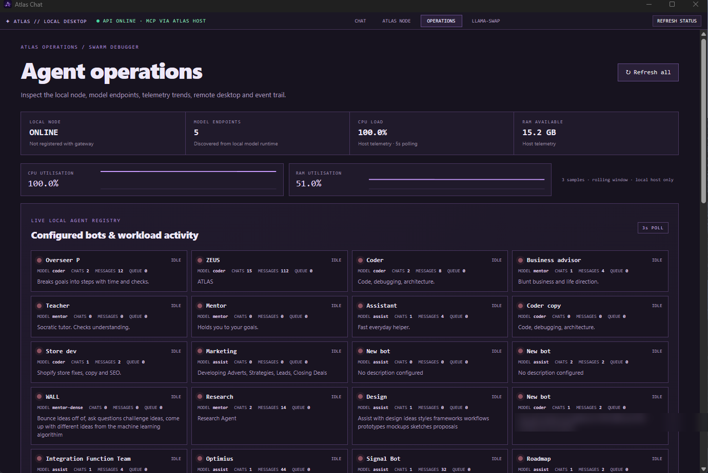
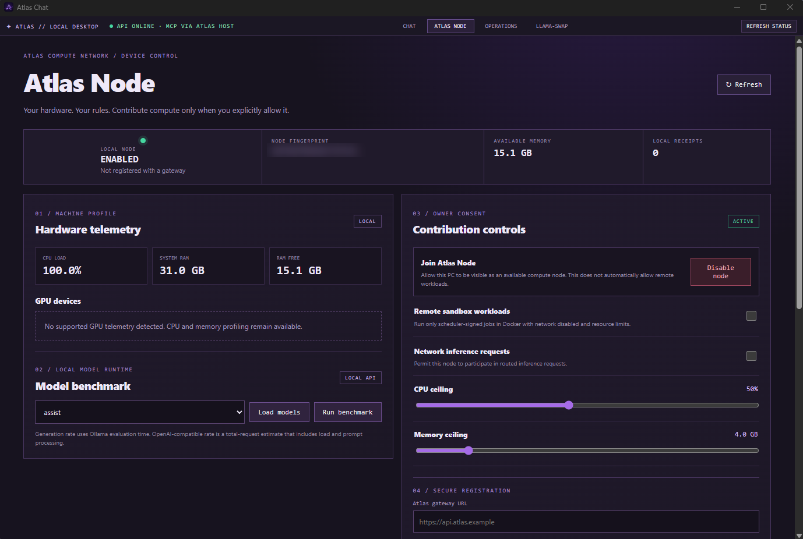
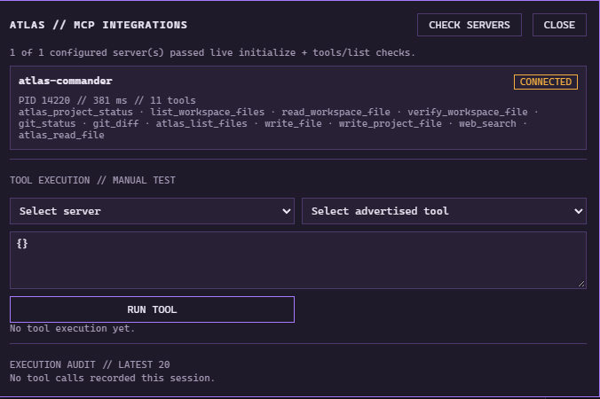
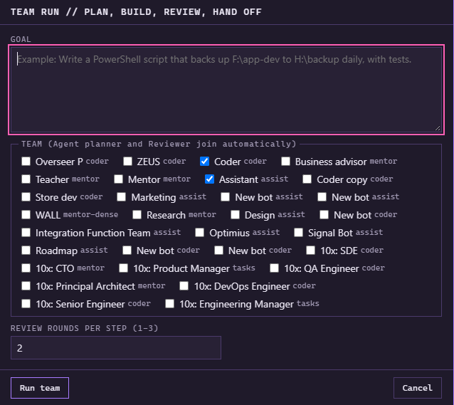
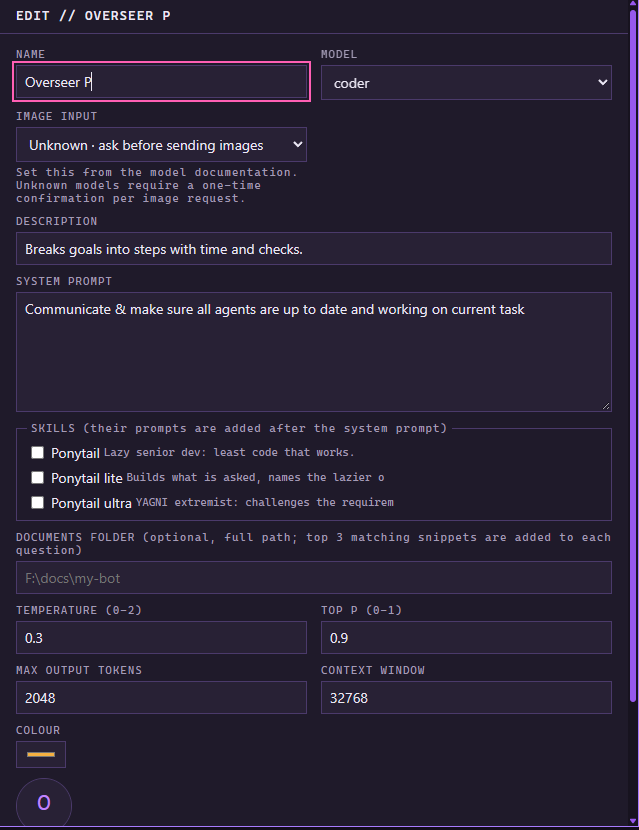
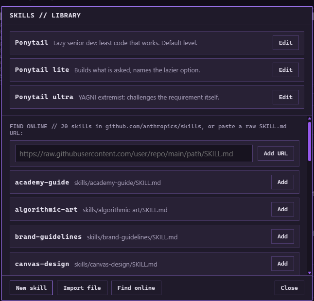
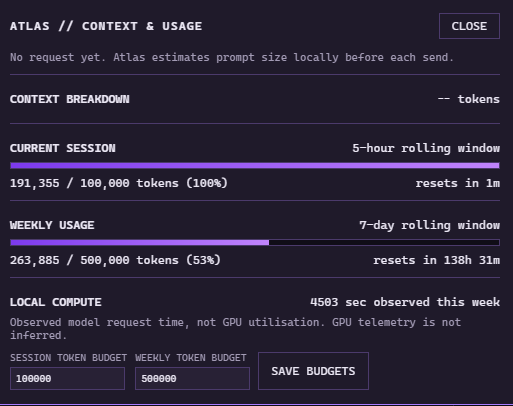
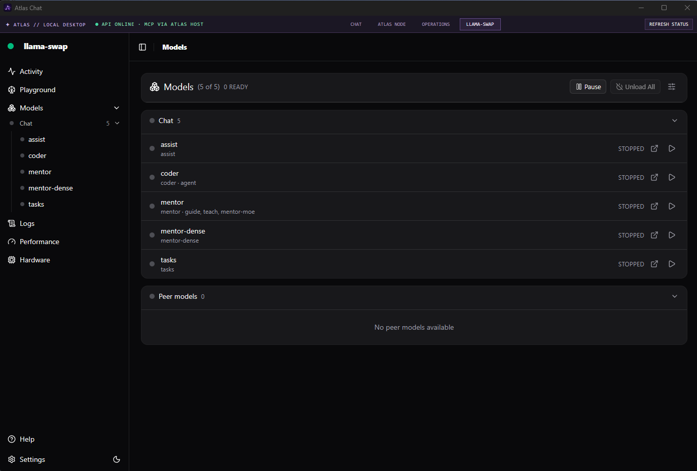
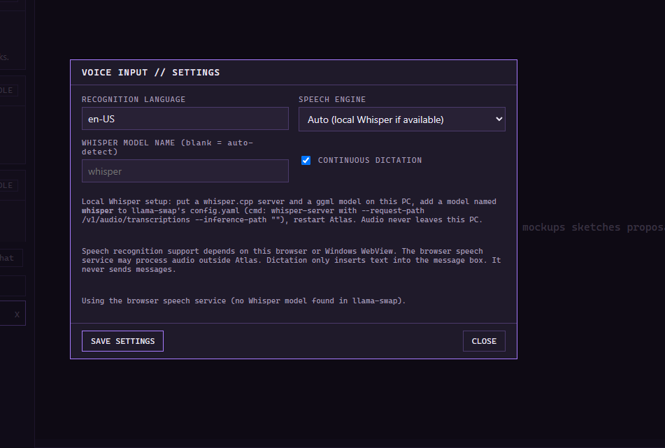

# Atlas Chat

A local AI chat app for Windows. It runs on your own PC, with your own models. Nothing goes to a cloud unless you set it up that way.

I built it because I wanted one app that does the things I actually use: chat with bots, give them tools, run a few of them on one goal, and use my laptop's GPU when my PC is busy.

**Status: pre-release.** I test it on my own PC. It works for me. It might not work for you yet. Read "What is tested" below before you trust any part of it.

## Screenshots

Agent operations page: bots, queue, CPU and RAM.



Atlas Node tab: hardware and model benchmark. The gateway part on this tab does not work yet.



<details>
<summary>More screenshots</summary>

MCP integrations: live server check, the tools each server offers, and a manual test box.



Team run: pick bots and a goal. A planner and a reviewer join on their own. You set 1 to 3 review rounds per step.



The bot editor: model, system prompt, skills, temperature and context size.



Skills library: your own skills, or add one from a URL.



Context and usage: prompt size, and session and weekly token budgets you set.



The llama-swap tab: the models it manages. This is the llama-swap dashboard, embedded in the app.



Voice input settings. Local Whisper if you set it up, or the browser speech service. The browser service may process audio outside Atlas.



</details>

## What it does

- **Bots.** Each bot has its own model, settings and chats. Make your own or edit the starter ones.
- **Local models.** It talks to [llama-swap](https://github.com/mostlygeek/llama-swap), which starts and stops llama.cpp models for you.
- **Skills.** Reusable prompt add-ons that you switch on per bot. Write your own, import a file, or add one from a URL.
- **Context and usage.** Shows the prompt size before you send. You set session and weekly token budgets.
- **MCP tools.** Bots can use MCP servers. The tool loop is bounded, and every tool call is logged.
- **Knowledge library.** Import your own documents and books. Atlas keeps the originals and makes separate notes from them.
- **Team run.** Pick bots and give a goal. The flow is plan, build, review, hand off.
- **`/swarm <goal>`.** Splits a goal into tasks, one per bot. Each bot gets its own chat with a live log in plain words. `/swarm stop` cancels everything and unloads the models.
- **Voice input.** Dictate into the message box. Use a local Whisper model through llama-swap, or the browser speech service. Dictation only fills the box. It never sends the message.
- **Operations page.** See tasks, events and what the models are doing.
- **Compute sharing.** Send a whole model request to another PC on your home network. See below.

## Compute sharing (PC and laptop)

If you have a second machine on your home network that runs llama-swap, Atlas can send a model to it. One request goes to one machine. I do not split one model across two machines. That is too slow on a home network.

- You list the models that live on the laptop. Everything else stays on your PC.
- Only home-network addresses work, unless you turn that on by hand in `settings.json`.
- Only the model port is used. The Atlas chat API stays on `127.0.0.1`.
- Each reply says which machine answered.

Setup steps are in [docs/compute-sharing/LAPTOP-SETUP.md](docs/compute-sharing/LAPTOP-SETUP.md).

The Atlas Node tab also has a part for a future paid network. **That part does not work yet.** It needs a gateway that does not exist. Do not expect any of it to do anything.

## Coding swarm (work in progress)

`agents/` has a separate coding swarm. It is not the `/swarm` chat command. It is scripts that split a coding job between workers. Rules that the code enforces:

- It rejects protected output paths.
- It runs commands with no shell, and with a time limit of 300 seconds at most.
- It only talks to your local model endpoint. It never calls a cloud model.

`agents/README.md` describes the local API that agents use to report their status to Atlas. That API only listens on `127.0.0.1`.

## What is tested

- Backend tests: `python -m unittest discover -s ../../../validation-tests -p "test_*.py"` from `atlas-rust-desktop/src-tauri/resources/atlas`. They pass in my cloud setup.
- Compute sharing is new. I tested it with a fake peer server. I have not tested it with a real laptop yet.
- Windows only. I have not tried Linux or macOS.
- A few tests in `tests/` fail on a clean checkout. I know about them and have not fixed them.

## Build it

You need Windows, Git, Node.js, Rust (MSVC toolchain), the Visual Studio C++ Build Tools, and WebView2.

The installer ships its own Python. That Python is **not in this repo**. Make the folder `atlas-rust-desktop/src-tauri/resources/atlas/runtime/python` with a working `python.exe` in it. The backend mostly uses the standard library. Extra packages are in `requirements.txt` and `requirements-knowledge.txt`.

Then run:

```powershell
.\build-release.ps1
```

It checks the backend, builds the app and an installer, and prints the installer path. It installs nothing by itself. Models are **not** included. You bring your own.

## Where things are

| Path | What |
|---|---|
| `atlas-rust-desktop/` | Tauri + Rust shell and the React frame |
| `atlas-rust-desktop/src-tauri/resources/atlas/` | Python backend and chat UI. This is what the installer ships |
| `validation-tests/`, `tests/` | Tests |
| `docs/` | Notes and the compute-sharing guide |
| `settings.example.json` | Copy to `settings.json` and edit |

## What is not in this repo

The paid gateway and control plane are not here. The gateway fields in the Atlas Node tab do nothing without them. You do not need them to run Atlas.

## Licence

Apache-2.0. See [LICENSE](LICENSE).
